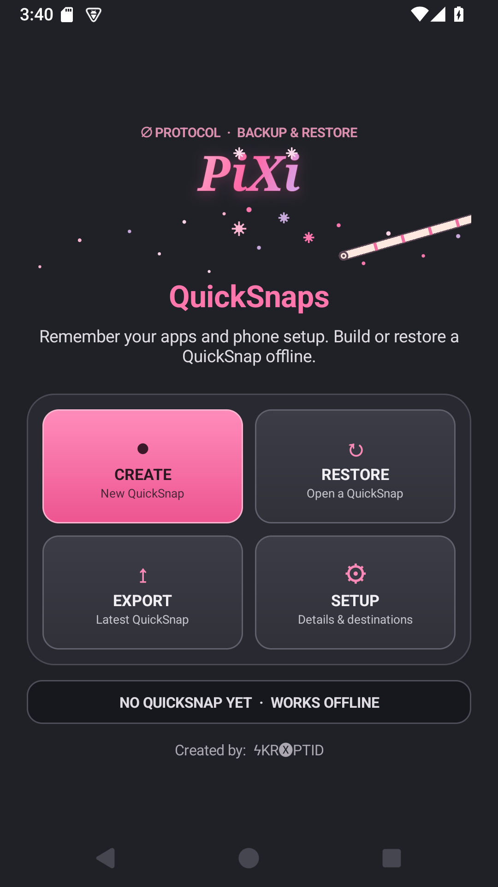

# PiXi QuickSnaps

**Remember your apps. Rebuild your setup. Keep it yours.**

A small, fully open-source Android setup recorder from ∅ Protocol, aimed at de-Googled phones. Create a QuickSnap on the phone while offline; save it locally or send it directly to your own server. No Google account, Google Play Services, root, subscription, analytics, or developer-operated cloud service required.

**0.1.2 is a public preview.** It provides an app inventory and assisted setup restore, with explicit user actions. It is not a full-device backup or an automatic replacement for Android's privileged restore services.

[Download the signed APK](https://github.com/sKRxPTiD/pixi-snapshot/releases/tag/v0.1.2) · [Privacy](PRIVACY.md) · [Release checks](docs/VALIDATION.md) · [MIT license](LICENSE)



## Four buttons

- **Create:** record your app inventory, profile name, notes, and selected setup files into one ZIP. The app shows its size before export.
- **Restore:** open an exported QuickSnap, see missing apps and source hints, and export saved setup files.
- **Export:** save the latest QuickSnap through Android's document picker, or send directly by SFTP. Choose send now or wait for an unmetered connection.
- **Setup:** select files, review app sources, edit independent server destinations, see privacy/license details, or cancel an export.

The main actions fit on one screen at typical phone settings. Smaller screens and larger accessibility text can scroll.

## What a QuickSnap remembers

App names, package IDs, versions, Android's reported installer package, and editable store/source labels and URLs. F-Droid and Aurora labels are recognized when Android reports their installer. Other sources can be labelled manually. It also records your setup profile, notes, device/Android details, and Android profiles visible to the current user.

Optional attachments: a **Nova Launcher backup**, a **wallpaper image**, and **home-screen screenshots**. These selections persist between launches. Choose a freshly saved Nova backup from Nova Settings → Backup & restore; PiXi does not trigger Nova's own backup process. On restore, export that file and import it through Nova.

PiXi does not include installed APKs, app-private data, account credentials, SSH keys, or downloaded maps automatically. App installs require your confirmation in the relevant store/installer. Source detection is best effort; it cannot always distinguish a manual APK from a store install. Widgets, permissions, accounts, wallpaper crop/lock-screen choices, Android user/work profiles, and some settings still need manual work. Notes and screenshots guide those steps. Nova is optional and is not bundled; the PiXi app and its included code/artwork are MIT licensed, with separate open-source notices for JSch and Bouncy Castle.

**Export a copy before wiping or uninstalling.** The internal QuickSnap is removed when app storage is cleared. ZIP copies are not password-encrypted. The preview caps uncompressed contents at 256 MiB, screenshots at 100, and inventory/notes at 2 MiB.

## Direct server export

Configure your own host, SSH port, username, existing writable folder, SSH private key, and trusted `known_hosts` file in Setup. The optional Dolo, Swervo, and Novo labels hold separate editable configurations; no personal addresses or credentials ship in the app.

The phone connects directly by SFTP, including over Tailscale if you have it configured. Dolo is not a relay. This preview supports SSH keys **without a passphrase** and checks host keys strictly. For a nonstandard port, the known_hosts entry normally uses `[host]:port`. Obtain and verify the server key through a trusted path. Use a dedicated key restricted to your backup destination.

Transfers are scheduled by Android, survive process restarts/reboots, show progress/results when notifications are allowed, and keep the destination chosen at queue time. They use a temporary remote file and rename it after verifying the uploaded size. A stopped transfer can leave a `.partial-*` file on an unreachable server; complete QuickSnaps keep the `.zip` name. Local copies are kept after success or failure. Android battery/network scheduling can delay exports. “Wait for Wi-Fi” uses Android's unmetered-network constraint, which can also match an unmetered Ethernet connection.

This preview stores one queued/active export at a time. Cancel it in Setup before replacing it. It does not synchronize, delete remote files, download remote QuickSnaps, or automatically retry authentication/configuration errors. Download a server copy to the phone yourself before opening it in Restore.

## Build from source

Android 8.0+ (API 26) is supported. Build with a Java 17+ JDK and Android SDK platform 36 / build tools 36.0.0. The checked-in wrapper pins Gradle 9.6.1 and verifies its distribution checksum; the Android Gradle Plugin, JSch, and Bouncy Castle versions are pinned. First build needs internet for build tools/dependencies.

```sh
export ANDROID_HOME="$HOME/Android/Sdk"
./build-local.sh
# Or: ./gradlew --no-daemon :app:assembleDebug :app:lintDebug
```

Debug APK: `app/build/outputs/apk/debug/app-debug.apk`. Keep the test/debug installation separate from the signed release; Android will not accept an update signed by a different key. Back up/export internal QuickSnaps before uninstalling a debug build.

For a signed release, create your own keystore outside the checkout and a private properties file containing `storeFile`, `storePassword`, `keyAlias`, and `keyPassword`. Then:

```sh
PIXI_SNAPSHOT_SIGNING_PROPERTIES=/private/path/keystore.properties ./build-release.sh
```

Release APK: `app/build/outputs/apk/release/app-release.apk`. Never commit keys or passwords. Official updates use the same release certificate; see [release notes](CHANGELOG.md). Build provenance is documented, but byte-for-byte reproducibility has not been established.

## Distribution and contributions

Official distribution currently uses GitHub Releases. F-Droid inclusion is a separate review/build process and has not been requested or approved yet. The app uses installed-package visibility (`QUERY_ALL_PACKAGES`) for its core inventory function. Google Play has additional policy review for that permission; there is no Play listing.

[Report bugs](https://github.com/sKRxPTiD/pixi-snapshot/issues) with the Android version and steps to reproduce. Do not attach a personal QuickSnap, SSH key, or private server details. See [CONTRIBUTING.md](CONTRIBUTING.md) and [SECURITY.md](SECURITY.md).

Copyright © 2026 Wolf (sKRxPTiD), Null Protocol. Released under the [MIT license](LICENSE). JSch, Bouncy Castle, and their incorporated components retain their MIT/BSD/ISC notices under `app/src/main/assets/licenses/`.

The generated Gradle wrapper is an Apache-2.0 build tool; its license and notice are retained under `gradle/`. It is not bundled in the APK.
